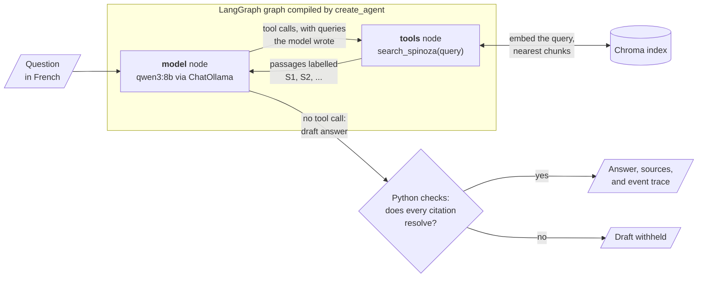
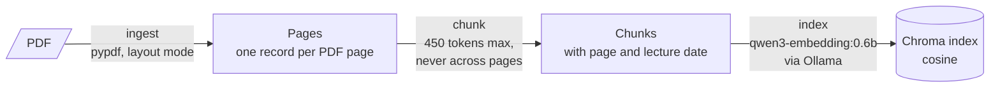

# Spinoza RAG

[](https://github.com/Geodego/spinoza-rag/actions/workflows/ci.yml)


A local research agent for Gilles Deleuze's lectures on Spinoza. Ask a question
in French: the agent decides what to look up in the lecture transcripts, calls
its retrieval tool, and writes a short answer whose citations each resolve to a
PDF page and a lecture date. A draft that fails that check is withheld.

The agent is a tool-calling loop built with LangChain `create_agent` on
LangGraph. Its single tool, `search_spinoza`, is vector retrieval (RAG) over a
Chroma index of the transcripts. Models run locally through Ollama: no cloud
services, no paid APIs, and the corpus never leaves the disk.

```console
$ uv run --locked python -m spinoza_rag.research answer \
    'Selon les passages, quels éléments composent le premier genre de connaissance ? Limite la réponse à cette définition.' \
    --top-k 1 --timeout 600
{"event": "model_end", "call": 1, "tool_calls": [{"name": "search_spinoza", "args": {"query": "premier genre de connaissance"}}]}
{"event": "search_start", "tool": "search_spinoza", "query": "premier genre de connaissance"}
{"event": "search_end", "retrieved": 1, "admitted_labels": ["S1"], "evidence_bytes": 1792}
{"event": "model_end", "call": 2, "prompt_seconds": 20.46, "generation_seconds": 10.78, "tool_calls": []}
{
  "answer": "<answer in French> [S1]",
  "sources": [{"label": "S1", "chunk_id": "sha256:33d8ebfa605328f7…",
    "metadata": {"source_file": "spinoza.pdf", "page_start": 314, "page_end": 314, "lecture_date": "1981-02-03"}}],
  "evidence_bytes": 1792,
  "elapsed_seconds": 45.27
}
```

The trace is from a real run, shortened and rounded: the model writes its own
query, receives one passage labelled `S1`, and cites it. The answer and passage
are placeholders because the transcripts are not distributed with this repository.

## How the agent works



`create_agent` compiles a graph with two nodes. `model` calls the chat model
with the system prompt, the messages so far, and the tool schema; `tools` runs
the requested searches. A conditional edge leaves `model` for `tools` when the
reply holds tool calls and for the end when it holds none, so the model decides
whether to search, with which query, and when to answer. Around that loop:

- **Limits are enforced in code, not by the prompt.** The tool refuses a third
  search, a `wrap_model_call` middleware fails the run at a fourth model call,
  and the graph's recursion limit is a backstop. Parallel tool calls in one
  model response share the same counters under a lock.
- **One in-process tool.** `search_spinoza` is a `@tool` closure over the run's
  session. Its schema reaches the model through Ollama tool calling (function
  calling); no Model Context Protocol (MCP) server or client is involved.
  Retrieval errors return to the model as JSON, not exceptions; the run continues.
- **Evidence is tracked outside the graph state**, which holds only `messages`.
  Admitted passages, their labels, the search counter, and the 8,000-byte
  evidence budget live in a per-run Python object that the model cannot read
  or reset. Passages are admitted whole or not at all.
- **Answers are checked after the graph ends.** An unknown label, a truncated
  reply, or a substantive answer without citations fails the run; only a fixed
  refusal may go uncited. If no passage was admitted, a fixed
  insufficient-evidence sentence replaces the draft.
- **Every step emits an event.** The JSON lines above come from the middleware
  and the tool, with Ollama's prompt and generation times kept separate. Hosted
  tracing is disabled and requests go only to a loopback Ollama URL.
- **Each question gets a fresh graph**: no checkpointer, store, or memory.

`research context` and `search` run the same retrieval without a chat model and
print the passages. Details: [agent workflow](docs/agent-workflow.md) (nodes,
routing, state, checks, events) · [research commands](docs/research-agent.md).

## The index behind the tool

The tool embeds only the query. The index is built offline, once; each stage is
a separate command that reads the previous stage's persisted artifacts.



- **Page and lecture provenance is preserved end to end.** The document ID is
  the SHA-256 of the PDF bytes, and chunks never cross a page or lecture
  boundary, so citations are exact, at the cost of occasionally splitting an
  argument. Lecture dates are inferred from standalone `DD.MM.YYYY` headings.
- **Artifacts are fingerprinted and never silently reused when stale.** Each
  manifest binds its inputs, settings, tokenizer, and the exact Ollama model
  digest. A changed setting requires a new output directory.
- **Indexing is resumable and idempotent.** Stable chunk IDs, upserts, and
  per-batch checkpoints mean an interrupted build resumes only missing chunks.

Details: [PDF extraction](docs/ingestion.md) · [chunking, indexing, and
search](docs/indexing-and-search.md) · [configuration](docs/configuration.md).

## Quickstart

### Prerequisites

- [uv](https://docs.astral.sh/uv/getting-started/installation/) and Git 2.28 or
  newer ([an older Git breaks the commit hooks](docs/development.md#toolchain)).
  Verified on macOS Intel with uv 0.12.1 and Python 3.12.13; CI tests on Linux.
- [Ollama](https://ollama.com/) running locally
- About 650 MB for embeddings and tokenizer, and about 5.2 GB for the agent's
  chat model, `qwen3:8b`
- Your own lawfully obtained PDF of the lectures, placed at `data/spinoza.pdf`
  (no corpus is bundled; see [Corpus and licensing](#corpus-and-licensing))

### One-time setup

```sh
git clone https://github.com/Geodego/spinoza-rag.git
cd spinoza-rag
uv sync --locked
ollama pull qwen3-embedding:0.6b
ollama pull qwen3:8b  # Chat model for the agent
mkdir -p models
curl --fail --location \
  https://huggingface.co/Qwen/Qwen3-Embedding-0.6B/resolve/97b0c614be4d77ee51c0cef4e5f07c00f9eb65b3/tokenizer.json \
  --output models/qwen3-embedding-tokenizer.json
shasum -a 256 models/qwen3-embedding-tokenizer.json
```

The tokenizer SHA-256 must be `def76fb086971c7867b829c23a26261e38d9d74e02139253b38aeb9df8b4b50a`.
Setup downloads packages, models, and tokenizer once; later commands never
download models or call hosted APIs.

### Build the index, then ask

```sh
uv run --locked python -m spinoza_rag.ingest   # PDF -> storage/ingestion-layout/
uv run --locked python -m spinoza_rag.chunk    # -> storage/chunks/
uv run --locked python -m spinoza_rag.index    # -> storage/index/ (about 30 min, see Results)
Q='Selon les passages, quels éléments composent le premier genre de connaissance ? Limite la réponse à cette définition.'
uv run --locked python -m spinoza_rag.research answer "$Q" --top-k 1 --timeout 600  # agent
uv run --locked python -m spinoza_rag.research context "$Q" --top-k 1  # passages only
uv run --locked python -m spinoza_rag.search "Que sont les notions communes ?" --top-k 3
```

Each stage's default output is the next stage's default input, and rerunning a
stage with unchanged inputs verifies and reuses its artifacts. Every command
accepts `--help`; `python -m spinoza_rag.config` prints all defaults.

## Results

**Agent runs.** Single runs on 2026-11-12 (macOS Intel, CPU inference), each
reviewed by hand against the passages the agent admitted; not a benchmark.

| Question | Searches | Time | Source review |
| --- | --- | --- | --- |
| Focused definition (example above) | 1 | 45 s | Answer supported by its cited passage |
| Joy versus sadness | 1 | 99 s | Citation resolves; the passage ends before supporting one claim |
| Two themes to relate | 2, in one model response | 103 s | Citations resolve; one claim contradicts its passage, one is misattributed |
| Detail absent from the retrieved passage | 1 | 37 s | Exact insufficient-evidence refusal |
| Off-corpus question | 0 | 7 s | Model skipped retrieval; draft withheld |

The checks catch unresolved labels, not unsupported claims: synthesis beyond
the evidence on broad questions is the main observed limitation. See the
[answer review log](docs/answer-review.md).

**Retrieval.** On the current local PDF (531 pages, 13 lecture dates): 1,194
chunks, median 299 tokens; a full index build takes 29 min 37 s (a rerun
re-embeds nothing) and a search about 0.9 s. Baseline of 2026-11-12 on ten
human-validated questions, exact PDF pages, 50 candidate chunks per question:

| Top k pages | Hit@k | Support recall@k | MRR@k |
| --- | --- | --- | --- |
| 1 | 80% | 21% | 0.80 |
| 3 | 100% | 41% | 0.88 |
| 5 | 100% | 48% | 0.88 |
| 10 | 100% | 64% | 0.88 |

Hit needs only one approved page; recall is the share of approved pages
retrieved, so a hit does not establish complete answer support. Details:
[retrieval evaluation](docs/evaluation.md#first-official-partial-baseline).

### Limitations

- Citations are checked for label resolution, not factual entailment.
- The model can skip retrieval; its draft is then withheld, not corrected.
- The retrieval baseline is a small, deliberately selected partial set.
- No reranking or hybrid search; hard page boundaries can split an argument.
- Extraction is not OCR, and transcription accuracy is only spot-checked.
- Single-document, sequential pipeline; concurrent writers are out of scope.

## Status and roadmap

**Work in progress.** Implemented: the bounded French answer agent (LangChain
`create_agent` on LangGraph) with its retrieval tool, citation checks, and
event trace; page-aware PDF extraction; token-aware chunking; local Ollama
embeddings; resumable Chroma indexing; and a reproducible retrieval evaluation.

Adjacent-page context, reranking, and equivalent-page or graded scoring are
deferred; see [later improvements](docs/future-improvements.md). A web
interface, multi-agent system, persistent memory, and MCP are out of scope.

## Technology

- **Agent:** LangChain `create_agent`, `@tool`, and `wrap_model_call`
  middleware on a LangGraph graph · langchain-ollama `ChatOllama`
- **Models:** Ollama `qwen3:8b` (chat, tool calling) and `qwen3-embedding:0.6b`
- **Retrieval:** Chroma · pypdf · LangChain text splitters with the Qwen3 tokenizer
- **Tooling:** Python 3.12 · uv · Ruff · mypy · pytest · GitHub Actions

## Development

```sh
uv sync --locked
uv run --locked prek install
uv run --locked ruff check .
uv run --locked ruff format --check .
uv run --locked mypy
uv run --locked pytest
```

Tests need neither the corpus nor Ollama: agent tests run the real graph with
scripted tool-calling chat models and fake retrieval; pipeline tests use
synthetic PDFs, fake embeddings, and real local Chroma persistence. See
[development](docs/development.md) for the full checks, [`AGENTS.md`](AGENTS.md)
for conventions, and [`docs/knowledge/`](docs/knowledge/README.md) for lessons.

## Corpus and licensing

The project is designed around transcripts of Gilles Deleuze's lectures on
Spinoza. The source PDF and extracted text are not included in this repository;
users must provide their own lawfully obtained copy.

The repository contains code, synthetic tests, and corpus-free question annotations.
Source PDFs, extracted text, chunks, embeddings, indexes, and models belong in
the Git-ignored `data/`, `storage/`, and `models/` directories. A code license
has not yet been chosen; corpus rights remain separate.
