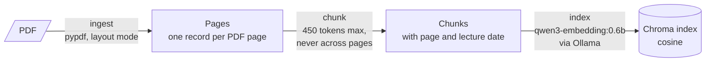
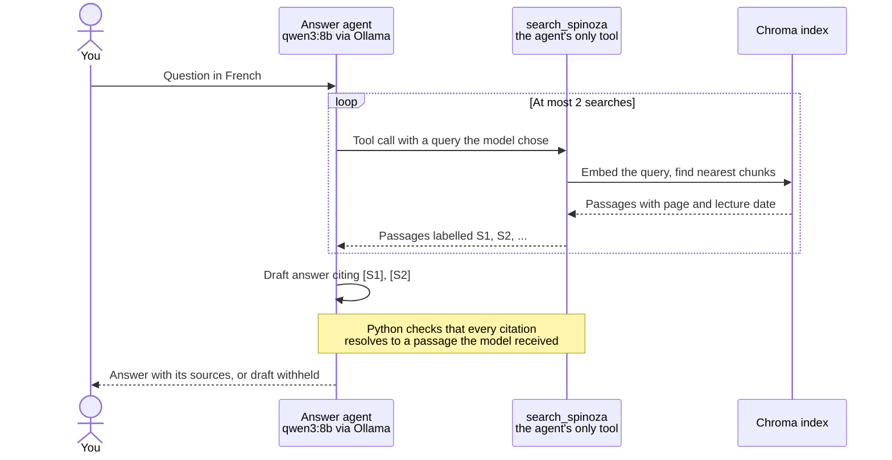

# Spinoza RAG

[](https://github.com/Geodego/spinoza-rag/actions/workflows/ci.yml)


A fully local research CLI for Gilles Deleuze's lectures on Spinoza. Ask a
question in French and inspect retrieved passages or request a bounded answer
with source labels, PDF pages and lecture metadata.

Everything runs on one machine: no cloud services, no paid APIs, and the corpus
never leaves the disk.

```console
$ uv run --locked python -m spinoza_rag.search \
    "Quelle est la différence entre la joie et la tristesse ?" --top-k 3

[1] spinoza.pdf | PDF pp. 66–66 | lecture: 1980-12-09 | cosine distance: 0.2094
Chunk: sha256:970f14788f236f62…
<passage text>

[2] spinoza.pdf | PDF pp. 291–291 | lecture: 1981-02-03 | cosine distance: 0.2236
Chunk: sha256:94d366d0384754a7…
<passage text>

[3] spinoza.pdf | PDF pp. 292–292 | lecture: 1981-02-03 | cosine distance: 0.2340
Chunk: sha256:64bc8ddb65f6a70e…
<passage text>
```

The output is real; the passage text and the full chunk IDs are shortened here
because the transcripts are not distributed with this repository.

## How it works

**1. Build the index (offline, once).** Each stage is a separate command that
reads the previous stage's persisted artifacts.



**2. Answer a question.** Retrieval is the agent's only tool: the chat model
chooses its own queries and calls `search_spinoza` through tool calling
(function calling).



Search embeds only the question; it never reprocesses the PDF or recomputes
document embeddings. The `search` and `research context` commands run the same
search without a chat model and print the passages. The tool is an in-process
Python function: no Model Context Protocol (MCP) server or client is involved.
See the [agent workflow](docs/agent-workflow.md).

Key design decisions:

- **Page provenance is preserved end to end.** The document ID is the SHA-256
  of the PDF bytes, and every chunk keeps its one-based PDF page. Chunks never
  cross page boundaries, so citations are exact, at the cost of occasionally
  splitting an argument across pages.
- **Lecture dates are inferred from the text.** Standalone `DD.MM.YYYY`
  headings become ISO lecture dates, and chunks never span two lectures.
- **Artifacts are fingerprinted and never silently reused when stale.** Each
  manifest binds its inputs, settings, tokenizer, and the exact Ollama model
  digest. A changed setting requires a new output directory instead of mixing
  incompatible vectors.
- **Indexing is resumable and idempotent.** Stable chunk IDs, upserts, and
  per-batch checkpoints mean an interrupted build resumes only missing chunks,
  and a complete rerun embeds nothing.
- **Layout-mode extraction is the default.** Plain extraction split words
  apart on sampled pages; layout mode fixed them. Both remain reproducible.

Details: [PDF extraction](docs/ingestion.md) ·
[chunking, indexing, and search](docs/indexing-and-search.md) ·
[research commands](docs/research-agent.md) ·
[configuration](docs/configuration.md).

## Quickstart

### Prerequisites

- [uv](https://docs.astral.sh/uv/getting-started/installation/) and Git 2.28 or
  newer. The full pipeline is verified on macOS Intel with uv 0.12.1 and Python
  3.12.13; CI runs the tests on Linux. If an old Git breaks the commit hooks, see
  [development](docs/development.md#toolchain).
- [Ollama](https://ollama.com/) running locally
- About 650 MB for embeddings and tokenizer; answer mode also needs the
  installed `qwen3:8b` model (about 5.2 GB)
- Your own lawfully obtained PDF of the lectures, placed at `data/spinoza.pdf`
  (no corpus is bundled; see [Corpus and licensing](#corpus-and-licensing))

### One-time setup

```sh
git clone https://github.com/Geodego/spinoza-rag.git
cd spinoza-rag
uv sync --locked
ollama pull qwen3-embedding:0.6b
ollama pull qwen3:8b  # Required for answer mode
mkdir -p models
curl --fail --location \
  https://huggingface.co/Qwen/Qwen3-Embedding-0.6B/resolve/97b0c614be4d77ee51c0cef4e5f07c00f9eb65b3/tokenizer.json \
  --output models/qwen3-embedding-tokenizer.json
shasum -a 256 models/qwen3-embedding-tokenizer.json
```

The tokenizer SHA-256 must be
`def76fb086971c7867b829c23a26261e38d9d74e02139253b38aeb9df8b4b50a`.
Setup downloads packages, models, and tokenizer once; later commands never
download models or call hosted APIs.

### Run the pipeline

```sh
uv run --locked python -m spinoza_rag.ingest   # PDF -> storage/ingestion-layout/
uv run --locked python -m spinoza_rag.chunk    # -> storage/chunks/
uv run --locked python -m spinoza_rag.index    # -> storage/index/ (about 30 min, see Results)
uv run --locked python -m spinoza_rag.search \
  "Que sont les notions communes ?" --top-k 3
```

Each stage's default output is the next stage's default input. Every command
accepts `--help`, and `python -m spinoza_rag.config` prints all defaults. Rerunning
a stage with unchanged inputs verifies and reuses its artifacts.

With the index ready, inspect evidence or request an answer:

```sh
uv run --locked python -m spinoza_rag.research context \
  'Selon les passages, quels éléments composent le premier genre de connaissance ? Limite la réponse à cette définition.' --top-k 1
uv run --locked python -m spinoza_rag.research answer \
  'Selon les passages, quels éléments composent le premier genre de connaissance ? Limite la réponse à cette définition.' --top-k 1 --timeout 600
```

See [the agent guide](docs/research-agent.md) for output examples and failure handling.

## Results

On the current local PDF (531 pages, 13 lecture dates):

- **1,194 chunks**, median 299 tokens, capped at 450.
- **Full index build:** 29 min 37 s on a macOS Intel machine (batch size 8); a rerun completes in
  under a second with nothing re-embedded. The index occupies about 21 MB.
- **Search:** about 0.9 s per question after startup, embedding exactly one
  text.
- **Retrieval baseline** (2026-11-12): ten human-validated questions, exact
  PDF pages, 50 candidate chunks per question; fifteen proposed questions are
  excluded.

| Top k pages | Hit@k | Support recall@k | MRR@k |
| --- | --- | --- | --- |
| 1 | 80% | 21% | 0.80 |
| 3 | 100% | 41% | 0.88 |
| 5 | 100% | 48% | 0.88 |
| 10 | 100% | 64% | 0.88 |

Hit needs only one approved page; recall is the share of approved pages
retrieved. Finding one relevant page does not establish complete answer
support. Per-question failures and the frozen configuration are in the
[retrieval evaluation](docs/evaluation.md#first-official-partial-baseline);
the targeted follow-up is [deferred](docs/future-improvements.md).
Reviewed answer runs, with timings and unsupported claims, are recorded in the
[answer review log](docs/answer-review.md).

### Limitations

- The official baseline is a small, deliberately selected partial set; its
  exact-page metrics do not establish complete supporting evidence or answer quality.
- Agent citations are checked for label resolution, not factual entailment.
- No reranking or hybrid (keyword + vector) search.
- Hard page boundaries can split an argument; short fragments and retained
  headers can add noise.
- Extraction is not OCR, and full transcription accuracy and reading order are
  only spot-checked.
- Single-document, sequential pipeline; concurrent writers are out of scope.

## Status and roadmap

**Work in progress.** Implemented: page-aware PDF extraction with diagnostics,
token-aware chunking, local Ollama embeddings, resumable Chroma indexing,
retrieval-only search, a reproducible evaluation CLI, and a bounded French
answer agent using LangChain create_agent backed by LangGraph. Synthetic tests
cover page metrics, annotation status, persistence, restart, compatibility
checks, errors, and the guarantee that search never re-embeds documents.

Adjacent-page context, reranking, and equivalent-page or graded scoring are
deferred. Their hypotheses and criteria for resuming are recorded in
[later improvements](docs/future-improvements.md).

A web interface, multi-agent system, persistent memory and MCP integration
remain out of scope.

## Technology

Python 3.12 · uv · pypdf · LangChain text splitters with the Qwen3 tokenizer ·
LangChain agents / LangGraph · Ollama (`qwen3:8b`, `qwen3-embedding:0.6b`) ·
Chroma (embedded, cosine) · Ruff · mypy · pytest · GitHub Actions

Runtime dependencies include pypdf, LangChain text splitters and agents,
langchain-ollama, tokenizers, and Chroma. Chroma's default embedding function
and telemetry are disabled, and the Ollama URL is restricted to loopback addresses.

## Development

```sh
uv sync --locked
uv run --locked prek install
uv run --locked ruff check .
uv run --locked ruff format --check .
uv run --locked mypy
uv run --locked pytest
```

Tests use synthetic PDFs, a generated tokenizer, fake embeddings, and real local
Chroma persistence; they need neither the corpus nor Ollama. CI runs on Linux.
See [development](docs/development.md) for the toolchain, full checks, repository
layout, and dependency maintenance, and [`AGENTS.md`](AGENTS.md) for coding
conventions. Reusable compatibility lessons are indexed in
[`docs/knowledge/`](docs/knowledge/README.md).

## Corpus and licensing

The project is designed around transcripts of Gilles Deleuze's lectures on
Spinoza. The source PDF and extracted text are not included in this repository;
users must provide their own lawfully obtained copy.

The repository contains code, synthetic tests, and corpus-free question annotations.
Source PDFs, extracted text, chunks, embeddings, indexes, and models belong in
the Git-ignored `data/`, `storage/`, and `models/` directories. A code license
has not yet been chosen; corpus rights remain separate.
