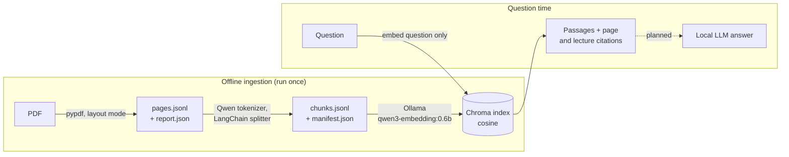

# Spinoza RAG

[](https://github.com/Geodego/spinoza-rag/actions/workflows/ci.yml)


A fully local retrieval system for Gilles Deleuze's lectures on Spinoza. Ask a
question in French and get the passages that address it, each cited to its
exact PDF page and lecture date.

The goal is source-grounded answers to philosophical questions. Retrieval is
implemented and measured; answer generation by a local LLM is the next stage.
Everything runs on one machine: no cloud services, no paid APIs, and the corpus
never leaves the disk.

```console
$ uv run --locked python -m spinoza_rag.search \
    "Quelle est la différence entre la joie et la tristesse ?" --top-k 3

[1] spinoza.pdf | PDF pp. 66–66 | lecture: 1980-12-09 | cosine distance: 0.2094
Chunk: sha256:970f14788f236f62…
<passage text>

[2] spinoza.pdf | PDF pp. 291–291 | lecture: 1981-02-03 | cosine distance: 0.2236
Chunk: sha256:94d366d0384754a7…
<passage text>

[3] spinoza.pdf | PDF pp. 292–292 | lecture: 1981-02-03 | cosine distance: 0.2340
Chunk: sha256:64bc8ddb65f6a70e…
<passage text>
```

The output is real; the passage text and the full chunk IDs are shortened here
because the transcripts are not distributed with this repository.

## How it works



Each stage is a separate command that reads the previous stage's persisted
artifacts. Search reopens the index and embeds only the question; it never
reprocesses the PDF or recomputes document embeddings.

Key design decisions:

- **Page provenance is preserved end to end.** The document ID is the SHA-256
  of the PDF bytes, and every chunk keeps its one-based PDF page. Chunks never
  cross page boundaries, so citations are exact, at the cost of occasionally
  splitting an argument across pages.
- **Lecture dates are inferred from the text.** Standalone `DD.MM.YYYY`
  headings become ISO lecture dates, and chunks never span two lectures.
- **Artifacts are fingerprinted and never silently reused when stale.** Each
  manifest binds its inputs, settings, tokenizer, and the exact Ollama model
  digest. A changed setting requires a new output directory instead of mixing
  incompatible vectors.
- **Indexing is resumable and idempotent.** Stable chunk IDs, upserts, and
  per-batch checkpoints mean an interrupted build resumes only missing chunks,
  and a complete rerun embeds nothing.
- **Layout-mode extraction is the default.** Plain extraction split words
  apart on sampled pages; layout mode fixed them. Both remain reproducible.

Details: [PDF extraction](docs/ingestion.md) ·
[chunking, indexing, and search](docs/indexing-and-search.md) ·
[configuration](docs/configuration.md).

## Quickstart

### Prerequisites

- [uv](https://docs.astral.sh/uv/getting-started/installation/) and Git 2.28 or
  newer. The full pipeline is verified on macOS Intel with uv 0.12.1 and Python
  3.12.13; CI runs the tests on Linux. If an old Git breaks the commit hooks, see
  [development](docs/development.md#toolchain).
- [Ollama](https://ollama.com/) running locally
- About 650 MB of disk for the embedding model and tokenizer
- Your own lawfully obtained PDF of the lectures, placed at `data/spinoza.pdf`
  (no corpus is bundled; see [Corpus and licensing](#corpus-and-licensing))

### One-time setup

```sh
git clone https://github.com/Geodego/spinoza-rag.git
cd spinoza-rag
uv sync --locked
ollama pull qwen3-embedding:0.6b
mkdir -p models
curl --fail --location \
  https://huggingface.co/Qwen/Qwen3-Embedding-0.6B/resolve/97b0c614be4d77ee51c0cef4e5f07c00f9eb65b3/tokenizer.json \
  --output models/qwen3-embedding-tokenizer.json
shasum -a 256 models/qwen3-embedding-tokenizer.json
```

The tokenizer SHA-256 must be
`def76fb086971c7867b829c23a26261e38d9d74e02139253b38aeb9df8b4b50a`.
Setup downloads packages, model, and tokenizer once; later commands never
download models or call hosted APIs.

### Run the pipeline

```sh
uv run --locked python -m spinoza_rag.ingest   # PDF -> storage/ingestion-layout/
uv run --locked python -m spinoza_rag.chunk    # -> storage/chunks/
uv run --locked python -m spinoza_rag.index    # -> storage/index/ (about 30 min, see Results)
uv run --locked python -m spinoza_rag.search \
  "Que sont les notions communes ?" --top-k 3
```

Each stage's default output is the next stage's default input. Every command
accepts `--help`, and `python -m spinoza_rag.config` prints all defaults. Rerunning
a stage with unchanged inputs verifies and reuses its artifacts.

## Results

On the current local PDF (531 pages, 13 lecture dates):

- **1,194 chunks**, median 299 tokens, capped at 450.
- **Full index build:** 29 min 37 s on a macOS Intel machine (batch size 8); a rerun completes in
  under a second with nothing re-embedded. The index occupies about 21 MB.
- **Search:** about 0.9 s per question after startup, embedding exactly one
  text.
- **Informal spot checks:** four of six French questions returned on-topic
  passages in the top three, with cosine distances of 0.13–0.25. Questions on
  *conatus* and *puissance/pouvoir* were weaker. Every returned passage was
  verified to appear on its cited page.

These are observations, not a benchmark. See
[corpus observations](docs/evaluation.md) for the method and per-question table.

### Limitations

- There is no gold-set retrieval evaluation yet, so semantic accuracy is not
  established.
- No answer generation, reranking, or hybrid (keyword + vector) search.
- Hard page boundaries can split an argument; short fragments and retained
  headers can add noise.
- Extraction is not OCR, and full transcription accuracy and reading order are
  only spot-checked.
- Single-document, sequential pipeline; concurrent writers are out of scope.

## Status and roadmap

**Work in progress.** Implemented: page-aware PDF extraction with diagnostics,
token-aware chunking, local Ollama embeddings, resumable Chroma indexing, and
retrieval-only search. Synthetic tests cover persistence, restart,
compatibility checks, errors, and the guarantee that search never re-embeds
documents.

The current milestone ends with a retrieval-quality review before the next one
is chosen. Candidate next steps:

- A small gold set of questions with expected pages, measuring recall@k and MRR.
- Retrieval improvements judged against that set (chunking, reranking, hybrid search).
- Answer generation with a local Ollama LLM, citing retrieved pages.

LangGraph orchestration, agents, and a web interface are out of scope for now.

## Technology

Python 3.12 · uv · pypdf · LangChain text splitters with the Qwen3 tokenizer ·
Ollama (`qwen3-embedding:0.6b`) · Chroma (embedded, cosine) · Ruff · pytest ·
GitHub Actions

Runtime dependencies are limited to pypdf, LangChain text splitters,
tokenizers, and Chroma. Chroma's default embedding function and telemetry are
disabled, and the Ollama URL is restricted to loopback addresses.

## Development

```sh
uv sync --locked
uv run --locked prek install
uv run --locked ruff check .
uv run --locked ruff format --check .
uv run --locked pytest
```

Tests use synthetic PDFs, a generated tokenizer, fake embeddings, and real local
Chroma persistence; they need neither the corpus nor Ollama. CI runs on Linux.
See [development](docs/development.md) for the toolchain, full checks, repository
layout, and dependency maintenance, and [`AGENTS.md`](AGENTS.md) for coding
conventions. Reusable compatibility lessons are indexed in
[`docs/knowledge/`](docs/knowledge/README.md).

## Corpus and licensing

The project is designed around transcripts of Gilles Deleuze's lectures on
Spinoza. The source PDF and extracted text are not included in this repository;
users must provide their own lawfully obtained copy.

The repository contains application code and synthetic test fixtures only.
Source PDFs, extracted text, chunks, embeddings, indexes, and models belong in
the Git-ignored `data/`, `storage/`, and `models/` directories. A code license
has not yet been chosen; corpus rights remain separate.
