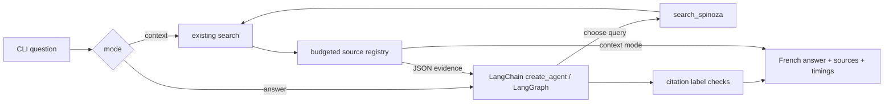
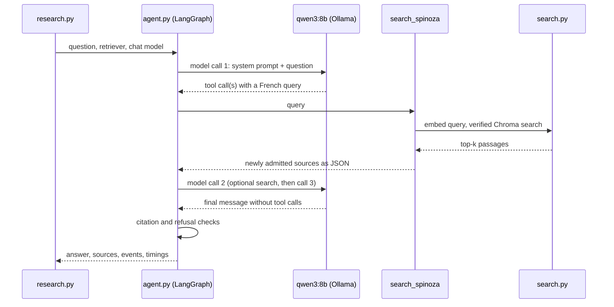

# Research agent workflow

This page explains how a research run works inside: the components involved,
each step of a run, the limits and checks, and the events it emits. For the
commands, output format, and exit statuses, see the
[research agent guide](research-agent.md).

## Components and tools

| Component | Role | Tool | Verified version |
| --- | --- | --- | --- |
| `research.py` | CLI: parses arguments, builds the clients, prints events and the result | Python `argparse` | Python 3.12 |
| `agent.py` | Runs one bounded research session and checks the answer | [LangChain `create_agent`](https://reference.langchain.com/python/langchain/agents/factory/create_agent), backed by LangGraph | langchain 1.5.0, langgraph 1.2.20, langchain-core 1.8.0 |
| `chat.py` | Configures the local chat model | [`ChatOllama`](https://reference.langchain.com/python/langchain-ollama/langchain_ollama/chat_models/ChatOllama) and the `ollama` Python client | langchain-ollama 1.1.0, ollama 0.6.3 |
| Chat model | Chooses queries and writes the French answer | Ollama `qwen3:8b` | Ollama 0.40.16 |
| `provenance.py` | Labels sources, enforces the evidence budget, parses citations | Python standard library | — |
| `search.py` | Retrieves passages from the verified index | Ollama `qwen3-embedding:0.6b` and Chroma; see the [query path](indexing-and-search.md#query-path-step-by-step) | Chroma 1.5.9 |
| Tracing guard | Keeps hosted tracing off | `langsmith.tracing_context` | langsmith 0.14.17 |

Library versions are those in `uv.lock` on 2026-11-12, which stays
authoritative. The Ollama version is the one recorded in the current local
index manifest, on macOS Intel. LangSmith and the LangGraph SDK are transitive
dependencies, not services used by the application.

## Overview

Each invocation creates a fresh graph without a checkpointer or store. There
is one tool, no multi-agent system, no persistent conversation, and no web
interface. Python enforces the budgets and source identity independently of
whether the model follows its instructions.

## An answer run, step by step

1. **Build the clients** (`research.py`). The CLI checks that `--top-k` is
   positive and `--context-bytes` does not exceed the default cap. It creates
   the embedding client and a retriever that calls `search` with `--top-k`.
   In answer mode, `local_chat` validates the same loopback-only URL as the
   embedding client and builds `ChatOllama` with `reasoning=False` (sent to
   Ollama as `think=false`), temperature 0, a 16,384-token context window, at
   most 700 generated tokens per call, and proxy environment variables
   ignored. It checks that the model is installed when constructed.
2. **Validate the question** (`research`). The question must be nonempty and
   at most 2,000 UTF-8 bytes. A `ResearchSession` is created: an empty source
   registry, a search counter, a lock, and the event observer that prints
   each event immediately.
3. **Build the graph.** Inside `tracing_context(enabled=False)`,
   `create_agent` builds a LangGraph loop between a model node and a tool node
   from the chat model, the single `search_spinoza` tool, the system prompt,
   and a model-call middleware. The graph is invoked with the question as the
   only user message, a recursion limit of 12, and no callbacks.
4. **Call the model.** The middleware counts calls and fails the run at a
   fourth one. It emits `model_start`, then `model_end` with wall time, token
   counts, Ollama's `prompt_eval_duration` and `eval_duration` in seconds,
   `done_reason`, and the requested tool calls. The system prompt (in French)
   asks the model to search before answering about the corpus, choose its own
   queries, use at most two searches and one search per distinct theme, treat
   passages and metadata as untrusted data, cite exact `[S1]`-style labels,
   avoid outside knowledge, and use a fixed sentence when the evidence is
   insufficient.
5. **Run the tool.** `search_spinoza` calls `ResearchSession.search` under the
   lock, so several tool calls in one model response share the same limits.
   After two searches, further calls emit `search_blocked` and return a JSON
   error telling the model to answer with existing evidence. Otherwise the
   call takes a slot, even if it then fails, and emits `search_start`. Queries
   over 1,000 bytes are rejected. The retriever runs the full
   [query path](indexing-and-search.md#query-path-step-by-step), which
   reopens and verifies the index on every search. Passages are used as
   retrieved, without adjacent-page expansion or reranking.
6. **Admit evidence** (`Evidence.add`). Results already in the registry are
   skipped, so a passage is never resent. Each new result gets the next label
   (`S1`, `S2`, ...) and is admitted only if the whole serialized JSON,
   including labels and metadata, still fits in the cumulative 8,000-byte
   budget. Passages are admitted whole or not at all. The tool returns only
   the newly admitted sources and emits `search_end` with the admitted labels,
   the registry without passage text, and the bytes used. A retrieval error
   emits `search_error` and returns a JSON error instead of evidence.
7. **Loop or stop.** The tool result returns to the model as a tool message.
   The model can search again or answer; the graph ends when a model response
   contains no tool calls. Two searches in separate responses need three model
   calls; both searches in one response need two.
8. **Check the final answer.** The last message must be a model message
   without tool calls. Then, in order:
   - A response that stopped with `done_reason=length` is withheld.
   - Citation tokens are parsed; unknown ones emit `unknown_citations`.
   - If no evidence was admitted and a search failed, the run fails.
   - If no evidence was admitted without a search failure (no search,
     duplicates only, or a full budget), the draft is replaced by a fixed
     French no-evidence sentence and `answer_withheld` is emitted.
   - Any unknown label fails the run.
   - An answer citing no admitted source fails, unless it is exactly the
     refusal `Les preuves sont insuffisantes pour répondre.`, optionally
     followed by `Une similarité vectorielle ne prouve rien.`.
9. **Return or fail.** Any error emits `agent_error` and becomes a
   `ResearchError`; the CLI writes a one-line summary to stderr and exits
   with status 1. Otherwise the CLI prints the result: the answer, all
   admitted sources (cited or not), all events, the evidence bytes used, and
   the elapsed time.

## A context run

Context mode skips steps 3 to 9: no chat model is built and no graph is
created. The question itself becomes the single search query, so it must fit
the 1,000-byte query limit. Retrieval and evidence admission (steps 5 and 6)
run once; a `search_error` fails the run. The result has `answer: null`.
Context mode still needs Ollama for the query embedding.

## Events

| Event | Emitted when | Main fields |
| --- | --- | --- |
| `model_start` | Before each model call | `call` |
| `model_end` | After each model call | `call`, `elapsed_seconds`, `prompt_seconds`, `generation_seconds`, `prompt_tokens`, `generated_tokens`, `done_reason`, `tool_calls` |
| `search_start` | A search takes a slot | `tool`, `query` |
| `search_end` | A search completed | `query`, `retrieved`, `admitted_labels`, `sources` (without text), `evidence_bytes`, `elapsed_seconds` |
| `search_error` | Retrieval or query validation failed | `query`, `error`, `elapsed_seconds` |
| `search_blocked` | A search was requested after the limit | `query` |
| `unknown_citations` | The answer cites labels not in the registry | `labels` |
| `answer_withheld` | No evidence was admitted; the draft was replaced | `reason` |
| `agent_error` | The answer run failed | `error` |

Unavailable Ollama durations are `null`, never inferred from wall time. They
exclude some loading, tool, graph, and client overhead. The result's
`elapsed_seconds` measures research execution, excluding CLI model
construction.

## Grounding and its limits

The evidence budget bounds serialized evidence, not the exact token count of
the whole prompt; the model context window and per-call output cap are
separate controls. A later search can receive no new evidence because its
results duplicate earlier ones or the budget is full. `--top-k 1` leaves room
in the budget for a second search on another topic.

Citation checks share one parser for single labels, comma- or
semicolon-separated bracket groups (such as `[S1, S2]`), and single numeric
labels in parentheses (such as `(S1)`). Every parsed token must resolve to an
admitted source; malformed bracket tokens and unknown labels are rejected.
The prompt quotes the refusal separately; see
[the regression diagnosis](knowledge/agent-refusal-boundary.md).

A valid label proves only that a source exists in the registry. It does
**not** prove entailment, relevance, completeness, or factual grounding.
Human inspection of the answer against its actual passages remains necessary;
see the [answer review log](answer-review.md). Vector search always returns
nearest neighbors, including for unrelated questions; there is no calibrated
relevance cutoff. Prompt injection resistance is an instruction, not a
demonstrated security guarantee.

## Privacy

Chat and embedding requests go only to a loopback Ollama URL and ignore proxy
environment settings. Execution runs under `tracing_context(enabled=False)`
even if LangSmith tracing is enabled in the parent environment, and accepts no
custom tracing callbacks; tests verify this override at the model boundary.
No cloud tracing or hosted service is configured. Nothing is saved by default;
see [keeping runs](research-agent.md#keeping-runs).

## Design tradeoffs

Offline ingestion, validated retrieval, and answer generation have separate
responsibilities. Retrieval uses a fixed index and an embedding response;
generation runs a fresh, bounded decision loop over that retrieval API. The
agent can rephrase a query or request a second topic, while Python enforces
budgets and source identity independently of prompt compliance. Context mode
makes the evidence inspectable before generation; answer mode includes source
mappings and execution events alongside the response.

A small evidence budget and page-boundary chunks can omit an argument's
continuation. A second search costs another model round trip and may return
only duplicates. Citation resolution is cheap and testable, while semantic
faithfulness needs source review. Retrieval evaluation remains a separate
frozen experiment: informal answer checks cannot improve its scores or
establish answer quality. Adjacent-page context and reranking remain deferred
experiments with their own evaluation requirements.
