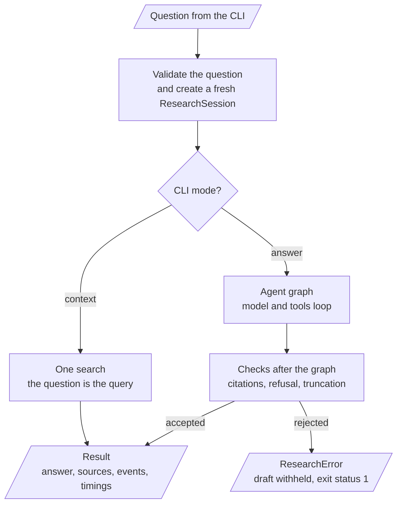
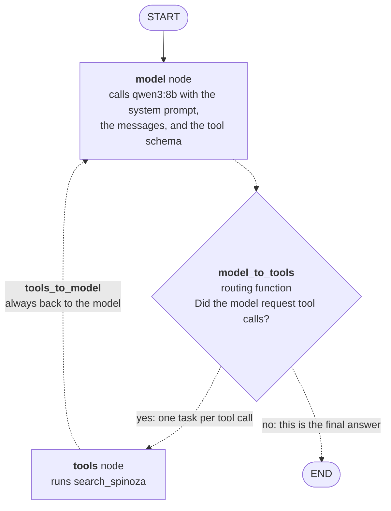
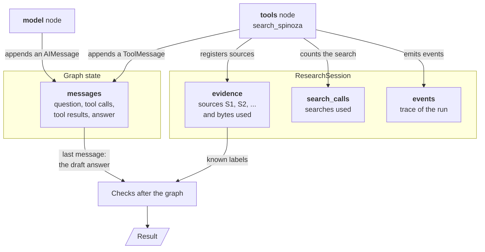
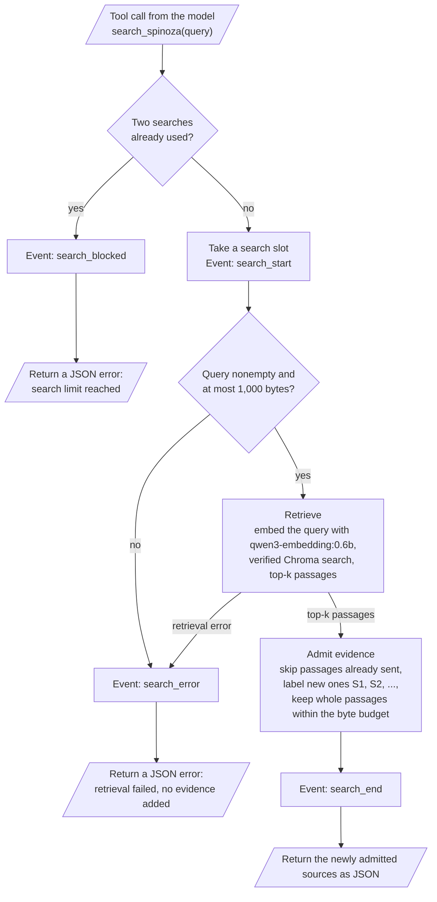
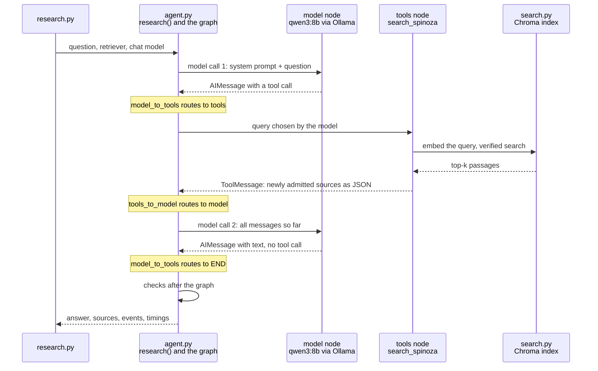

# Research agent workflow

This page explains how a research run works inside: the graph and its nodes,
the routing between them, the state, the retrieval tool, each step of a run,
the limits and checks, and the events it emits. For the commands, output
format, and exit statuses, see the [research agent guide](research-agent.md).

## At a glance

| Question | Answer |
| --- | --- |
| What runs the agent? | One LangGraph graph, built by LangChain `create_agent` for each question |
| Which nodes does it have? | Two: `model` (calls the chat model) and `tools` (runs `search_spinoza`) |
| Is a node a router? | No. Routing is done by two conditional edges, not by a node. The decisive one, `model_to_tools`, leaves the `model` node and picks `tools` or `END` |
| Who decides the route? | The chat model, by emitting tool calls or not. The routing function only reads that decision from the state |
| What is the graph state? | One channel, `messages`: the conversation of this run, appended to by both nodes |
| What else is tracked? | A per-run `ResearchSession` in Python, outside the graph: the source registry, search counter, and events |
| Which tools does the model have? | One: `search_spinoza(query)`, vector retrieval over the local index |
| What is not used? | No checkpointer, store, memory across questions, multi-agent system, or MCP |

Details and charts for each row follow: [the run](#run-overview),
[the graph](#the-graph-nodes-edges-and-routing), [the state](#state),
[the tool](#the-retrieval-tool), and
[the checks after the graph](#checks-after-the-graph).

## Components and tools

| Component | Role | Tool | Verified version |
| --- | --- | --- | --- |
| `research.py` | CLI: parses arguments, builds the clients, prints events and the result | Python `argparse` | Python 3.12 |
| `agent.py` | Runs one bounded research session and checks the answer | [LangChain `create_agent`](https://reference.langchain.com/python/langchain/agents/factory/create_agent), backed by LangGraph | langchain 1.5.0, langgraph 1.2.20, langchain-core 1.8.0 |
| `chat.py` | Configures the local chat model | [`ChatOllama`](https://reference.langchain.com/python/langchain-ollama/langchain_ollama/chat_models/ChatOllama) and the `ollama` Python client | langchain-ollama 1.1.0, ollama 0.6.3 |
| Chat model | Chooses queries and writes the French answer | Ollama `qwen3:8b` | Ollama 0.40.16 |
| `provenance.py` | Labels sources, enforces the evidence budget, parses citations | Python standard library | — |
| `search.py` | Retrieves passages from the verified index | Ollama `qwen3-embedding:0.6b` and Chroma; see the [query path](indexing-and-search.md#query-path-step-by-step) | Chroma 1.5.9 |
| Tracing guard | Keeps hosted tracing off | `langsmith.tracing_context` | langsmith 0.14.17 |

Library versions are those in `uv.lock` on 2026-11-12, which stays
authoritative. The Ollama version is the one recorded in the current local
index manifest, on macOS Intel. LangSmith and the LangGraph SDK are transitive
dependencies, not services used by the application.

## Run overview

The graph is only one part of an answer run. Python validates the input before
it and checks the answer after it. Context mode never builds the graph.

`CLI mode?` is an ordinary Python `if` in `research()`, not part of the graph.
Each invocation creates a fresh graph without a checkpointer or store. There
is one tool, no multi-agent system, no persistent conversation, and no web
interface. Python enforces the budgets and source identity independently of
whether the model follows its instructions.

## The graph: nodes, edges, and routing

`create_agent` compiles a LangGraph `StateGraph`. The chart below matches
`graph.get_graph()` for the installed versions, checked on 2026-11-12 with a
fake chat model.

Rectangles are nodes, the diamond is a routing function, solid arrows are
normal edges, and dashed arrows are conditional edges. The diamond is the
decision made on the conditional edge leaving `model`; it is not a third node
and writes nothing to the state.

### Nodes

| Node | What it does | Reads from the state | Writes to the state |
| --- | --- | --- | --- |
| `START` | LangGraph's entry point; passes the input to `model` | — | The input: one user message |
| `model` | Calls the chat model once. The request holds the system prompt, every message so far, and the schema of `search_spinoza` | `messages` | One `AIMessage`: either tool calls or the final text |
| `tools` | Executes one requested `search_spinoza` call (LangGraph `ToolNode`) | The tool call | One `ToolMessage` holding the tool's JSON string |
| `END` | LangGraph's exit point; `invoke` returns the final state | — | — |

Neither node is a router: both do work and return a state update. The
model-call middleware `observe_model` wraps the chat model call inside the
`model` node to count calls and emit events; it adds no node and no edge.

### Edges and routing functions

| From | Kind | Routing function | Destinations |
| --- | --- | --- | --- |
| `START` | Normal edge | — | Always `model` |
| `model` | Conditional edge | `model_to_tools` | `tools` when the last `AIMessage` has tool calls; `END` when it has none |
| `tools` | Conditional edge | `tools_to_model` | Always `model` in this application |

Both routing functions come from LangChain; the repository does not define
them. They contain no LLM call: `model_to_tools` only inspects the last
`AIMessage` in `messages`. The chat model makes the decision when it chooses
to emit tool calls or plain text, and the routing function turns that decision
into the next node. Tool calling is not forced (`tool_choice` is unset), so
the model may answer without searching; the
[checks after the graph](#checks-after-the-graph) handle that case.

Details that the chart leaves out:

- **Parallel tool calls.** When one model response holds two tool calls,
  `model_to_tools` returns one `Send("tools", ...)` per call, so the `tools`
  node runs once per call in the same step. A lock in `ResearchSession`
  serializes them, so the search limit still holds.
- **Unused routes.** `tools_to_model` can go to `END` only for tools declared
  with `return_direct` or for structured output; this application uses
  neither. `model_to_tools` also declares a `model` → `model` route for
  middleware jumps and injected tool messages, which never occur here.
- **Loop bounds.** The graph itself has no iteration limit. The middleware
  fails the run at a fourth model call, the tool refuses a third search, and
  `recursion_limit=12` is a backstop on graph steps. The longest valid run
  takes five steps: model, tools, model, tools, model.

## State

Two separate things hold data during an answer run. Only the first is graph
state in the LangGraph sense, and only the first is sent to the model. The
second is a Python object that the model never sees.

### Graph state

The state schema is LangChain's `AgentState`. The run uses one channel:

| Channel | Type | Reducer | Written by |
| --- | --- | --- | --- |
| `messages` | List of chat messages | `add_messages`: updates are appended, not overwritten | The input, the `model` node, the `tools` node |

`AgentState` also declares `jump_to` and `structured_response`. Both stay
unset: no middleware requests a jump and no structured output is configured.

Each node returns a partial update, `{"messages": [...]}`, and the reducer
appends it. The state after each step of a run with two separate searches:

| After | `messages` | Next, chosen by |
| --- | --- | --- |
| `invoke` input | `HumanMessage` (the question) | Normal edge to `model` |
| `model`, call 1 | + `AIMessage` with a `search_spinoza` tool call | `model_to_tools` → `tools` |
| `tools` | + `ToolMessage` with sources `S1`, ... as JSON | `tools_to_model` → `model` |
| `model`, call 2 | + `AIMessage` with a second tool call | `model_to_tools` → `tools` |
| `tools` | + `ToolMessage` with the newly admitted sources | `tools_to_model` → `model` |
| `model`, call 3 | + `AIMessage` with text and no tool call | `model_to_tools` → `END` |

Three properties follow from the code:

- **The system prompt is not in the state.** `create_agent` prepends it to
  the request at every model call, so `messages` starts with the question.
- **The state lives for one `invoke`.** There is no checkpointer and no
  `thread_id`, so nothing is saved and the next question starts empty.
- **Only the last message leaves the graph.** `research()` reads
  `state["messages"][-1]` as the draft answer and discards the rest.

### Run state outside the graph

`ResearchSession` is a plain Python object created for each question. The tool
is a closure over it, so the `tools` node updates it as a side effect.

| Field | Holds | Used for |
| --- | --- | --- |
| `evidence.sources` | Every admitted passage with its label, chunk ID, text, metadata, and distance | Resolving citations; the `sources` of the result |
| `evidence.used_bytes` | UTF-8 bytes of serialized evidence sent so far | The 8,000-byte evidence budget |
| `search_calls` | Searches that took a slot, including failed ones | The two-search limit |
| `events` | Every emitted [event](#events), in order | The trace printed by the CLI and returned in the result |

These values stay outside `messages` on purpose: the model cannot read,
reset, or overwrite them, so the limits and the citation checks do not depend
on the model following its prompt.

## The retrieval tool

The agent has exactly one tool, `search_spinoza`. It is the only way the model
reaches the corpus.

| Property | Value |
| --- | --- |
| Declared in | `ResearchSession.search_tool()` in `agent.py`, with LangChain's `@tool` decorator |
| Name seen by the model | `search_spinoza` |
| Arguments | `query` (string), written by the model |
| Description seen by the model | The function's docstring: a focused French query per topic, at most two calls, stable labels, possibly empty results |
| Transport | In-process Python call. The schema reaches the model through Ollama tool calling (function calling) |
| Returns | A JSON string, which the `tools` node wraps in a `ToolMessage` |
| Limits | Two calls per run; query of 1 to 1,000 UTF-8 bytes; 8,000 bytes of cumulative evidence |

It is not served over the Model Context Protocol (MCP), and the application
contains no MCP server or client.

### Inside one tool call

Every exit returns a string to the model; the tool never raises for these
cases, so the graph continues and the model sees what happened.

| Outcome | String returned to the model |
| --- | --- |
| Sources admitted | A JSON array; each item has `label`, `chunk_id`, `text`, `metadata` (source file, PDF pages, lecture date), and `distance` |
| Nothing new admitted | `[]`: every result was a duplicate or did not fit the budget |
| Limit reached | `{"error":"Search limit reached; answer with existing evidence."}` |
| Invalid query or retrieval failure | `{"error": "Retrieval failed; no evidence added."}` |

How the steps work:

- **Slots.** `ResearchSession.search` runs under a lock, so several tool calls
  in one model response share the same limits. A call takes a slot even if it
  then fails.
- **Retrieval.** The retriever runs the full
  [query path](indexing-and-search.md#query-path-step-by-step), which reopens
  and verifies the index on every search. Passages are used as retrieved,
  without adjacent-page expansion or reranking.
- **Admission** (`Evidence.add`). Results already in the registry are
  skipped, so a passage is never resent. Each new result gets the next label
  and is admitted only if the whole serialized JSON, including labels and
  metadata, still fits in the cumulative budget. Passages are admitted whole
  or not at all.
- **Events.** `search_end` carries the admitted labels, the registry without
  passage text, and the bytes used; see [events](#events).

## An answer run, step by step

The chart shows one search. A second search repeats the tool round trip and
needs a third model call.

1. **Build the clients** (`research.py`). The CLI checks that `--top-k` is
   positive and `--context-bytes` does not exceed the default cap. It creates
   the embedding client and a retriever that calls `search` with `--top-k`.
   In answer mode, `local_chat` validates the same loopback-only URL as the
   embedding client and builds `ChatOllama` with `reasoning=False` (sent to
   Ollama as `think=false`), temperature 0, a 16,384-token context window, at
   most 700 generated tokens per call, and proxy environment variables
   ignored. It checks that the model is installed when constructed.
2. **Validate the question** (`research`). The question must be nonempty and
   at most 2,000 UTF-8 bytes. A `ResearchSession` is created: an empty source
   registry, a search counter, a lock, and the event observer that prints
   each event immediately.
3. **Build the graph.** Inside `tracing_context(enabled=False)`,
   `create_agent` builds [the graph](#the-graph-nodes-edges-and-routing) from
   the chat model, the single `search_spinoza` tool, the system prompt, and
   the model-call middleware. The graph is invoked with the question as the
   only user message, a recursion limit of 12, and no callbacks.
4. **Call the model** (`model` node). The middleware counts calls and fails
   the run at a fourth one. It emits `model_start`, then `model_end` with wall
   time, token counts, Ollama's `prompt_eval_duration` and `eval_duration` in
   seconds, `done_reason`, and the requested tool calls. The system prompt (in
   French) asks the model to search before answering about the corpus, choose
   its own queries, use at most two searches and one search per distinct
   theme, treat passages and metadata as untrusted data, cite exact
   `[S1]`-style labels, avoid outside knowledge, and use a fixed sentence when
   the evidence is insufficient.
5. **Route.** `model_to_tools` sends the run to the `tools` node when the
   response holds tool calls, and to `END` otherwise.
6. **Run the tool** (`tools` node). Each call follows
   [the tool flow](#inside-one-tool-call) and appends a `ToolMessage`.
7. **Loop.** `tools_to_model` returns to the `model` node, which now sees the
   tool result and can search again or answer. Two searches in separate
   responses need three model calls; both searches in one response need two.
8. **Check the final answer.** After `END`, `research()` applies the
   [checks after the graph](#checks-after-the-graph).
9. **Return or fail.** Any error emits `agent_error` and becomes a
   `ResearchError`; the CLI writes a one-line summary to stderr and exits
   with status 1. Otherwise the CLI prints the result: the answer, all
   admitted sources (cited or not), all events, the evidence bytes used, and
   the elapsed time.

## Checks after the graph

These checks are plain Python in `research()`. They run once, after the graph
reaches `END`, and are not graph nodes.

The first matching row decides the outcome. "Fail" means a `ResearchError`:
the draft is withheld and the CLI exits with status 1.

| Order | Condition | Outcome | Event |
| --- | --- | --- | --- |
| 1 | The last message is not a model message, or still holds tool calls | Fail | `agent_error` |
| 2 | The response stopped at the generation limit (`done_reason=length`) | Fail | `agent_error` |
| 3 | No source was admitted and a search failed | Fail | `agent_error` |
| 4 | No source was admitted: no search, duplicates only, or a full budget | Return a fixed French no-evidence sentence instead of the draft | `answer_withheld` |
| 5 | The answer cites a label that is not in the registry | Fail | `unknown_citations`, `agent_error` |
| 6 | The answer cites at least one admitted source | Return the answer | — |
| 7 | The answer is exactly `Les preuves sont insuffisantes pour répondre.`, optionally followed by `Une similarité vectorielle ne prouve rien.` | Return the refusal | — |
| 8 | Anything else: a substantive answer without citations | Fail | `agent_error` |

Row 5 also emits `unknown_citations` when row 3 or 4 decides the outcome. A
passing answer proves only that its labels resolve; see
[grounding and its limits](#grounding-and-its-limits).

## A context run

Context mode skips steps 3 to 9: no chat model is built and no graph is
created, so there are no nodes, no routing, and no `messages` state. The
question itself becomes the single search query, so it must fit the 1,000-byte
query limit. `ResearchSession.search` runs once, following the same
[tool flow](#inside-one-tool-call); a `search_error` fails the run. The result has `answer: null`.
Context mode still needs Ollama for the query embedding.

## Events

| Event | Emitted when | Main fields |
| --- | --- | --- |
| `model_start` | Before each model call | `call` |
| `model_end` | After each model call | `call`, `elapsed_seconds`, `prompt_seconds`, `generation_seconds`, `prompt_tokens`, `generated_tokens`, `done_reason`, `tool_calls` |
| `search_start` | A search takes a slot | `tool`, `query` |
| `search_end` | A search completed | `query`, `retrieved`, `admitted_labels`, `sources` (without text), `evidence_bytes`, `elapsed_seconds` |
| `search_error` | Retrieval or query validation failed | `query`, `error`, `elapsed_seconds` |
| `search_blocked` | A search was requested after the limit | `query` |
| `unknown_citations` | The answer cites labels not in the registry | `labels` |
| `answer_withheld` | No evidence was admitted; the draft was replaced | `reason` |
| `agent_error` | The answer run failed | `error` |

Unavailable Ollama durations are `null`, never inferred from wall time. They
exclude some loading, tool, graph, and client overhead. The result's
`elapsed_seconds` measures research execution, excluding CLI model
construction.

## Grounding and its limits

The evidence budget bounds serialized evidence, not the exact token count of
the whole prompt; the model context window and per-call output cap are
separate controls. A later search can receive no new evidence because its
results duplicate earlier ones or the budget is full. `--top-k 1` leaves room
in the budget for a second search on another topic.

Citation checks share one parser for single labels, comma- or
semicolon-separated bracket groups (such as `[S1, S2]`), and single numeric
labels in parentheses (such as `(S1)`). Every parsed token must resolve to an
admitted source; malformed bracket tokens and unknown labels are rejected.
The prompt quotes the refusal separately; see
[the regression diagnosis](knowledge/agent-refusal-boundary.md).

A valid label proves only that a source exists in the registry. It does
**not** prove entailment, relevance, completeness, or factual grounding.
Human inspection of the answer against its actual passages remains necessary;
see the [answer review log](answer-review.md). Vector search always returns
nearest neighbors, including for unrelated questions; there is no calibrated
relevance cutoff. Prompt injection resistance is an instruction, not a
demonstrated security guarantee.

## Privacy

Chat and embedding requests go only to a loopback Ollama URL and ignore proxy
environment settings. Execution runs under `tracing_context(enabled=False)`
even if LangSmith tracing is enabled in the parent environment, and accepts no
custom tracing callbacks; tests verify this override at the model boundary.
No cloud tracing or hosted service is configured. Nothing is saved by default;
see [keeping runs](research-agent.md#keeping-runs).

## Design tradeoffs

Offline ingestion, validated retrieval, and answer generation have separate
responsibilities. Retrieval uses a fixed index and an embedding response;
generation runs a fresh, bounded decision loop over that retrieval API. The
agent can rephrase a query or request a second topic, while Python enforces
budgets and source identity independently of prompt compliance. Context mode
makes the evidence inspectable before generation; answer mode includes source
mappings and execution events alongside the response.

A small evidence budget and page-boundary chunks can omit an argument's
continuation. A second search costs another model round trip and may return
only duplicates. Citation resolution is cheap and testable, while semantic
faithfulness needs source review. Retrieval evaluation remains a separate
frozen experiment: informal answer checks cannot improve its scores or
establish answer quality. Adjacent-page context and reranking remain deferred
experiments with their own evaluation requirements.
