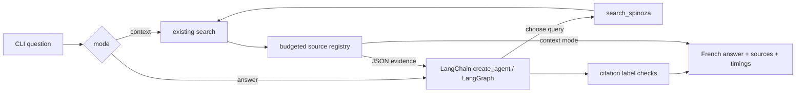

# Local research agent

## Commands

Run from the repository root after building the existing index and starting
Ollama with `qwen3:8b` and `qwen3-embedding:0.6b` already installed:

```sh
uv run --locked python -m spinoza_rag.research context \
  'Quelle est la différence entre la joie et la tristesse ?' --top-k 2
uv run --locked python -m spinoza_rag.research answer \
  'Quelle est la différence entre la joie et la tristesse ?' --top-k 1 --timeout 600
```

`context` retrieves passages and provenance without constructing a chat model.
It still uses Ollama **embeddings**. `answer` asks the local model to choose
queries, optionally gather follow-up evidence, and answer in French with `[S1]`
citations. The original `spinoza_rag.search` CLI remains retrieval-only and
unchanged. `--help` lists index, model, retrieval, timeout and evidence limits.
The timeout applies to each request, not to the whole run.

Exact commands and reviewed outcomes: [local demonstration](demonstration.md).

## Architecture and bounds



`ResearchSession` wraps exactly the existing `search` function through an
injected retriever. It preserves embedding identity, manifest checks, upstream
checksums and the official ranking path. Each search reopens and verifies the
index. There is no adjacent-page expansion, reranking, new index, or modification
to the frozen gold set or official baseline.

Each invocation creates a fresh graph without a checkpointer or store. There is
one tool, a lock-protected two-search limit (including failed attempts), three
model calls at most, and a graph recursion guard. Multiple tool calls in one
model response share the same limits. Excess searches return a tool error;
continued tool loops fail visibly. There is no multi-agent system, persistent
conversation, or web interface. See [configuration](configuration.md#local-chat-and-evidence-defaults)
for centralized model, question, output and evidence budgets.

Only complete chunks fitting the cumulative UTF-8 JSON evidence budget are
admitted. Labels are assigned in admission order and reused for each chunk ID;
duplicate passages are not resent. A later search can receive no new evidence
because its results duplicate earlier ones or the budget is full. The budget
bounds serialized evidence, not the exact tokenizer count of the whole prompt;
Ollama's model context window and per-call output cap are separate controls.
`--top-k 1` is useful for leaving room for a second topic in a demonstration.

## Grounding and failures

The system prompt treats passages and metadata as untrusted data, requests
retrieval before corpus answers, requires citations and explicit acknowledgement
of insufficient evidence, and forbids outside knowledge. `ChatOllama` sets
`reasoning=False` explicitly, sending Ollama `think=false`.

The application withholds unsupported drafts when no evidence was admitted,
rejects unknown source labels, uncited substantive output and final responses
marked `done_reason=length`. Without citations, accept only the exact claim-free
refusal `Les preuves sont insuffisantes pour répondre.`, optionally followed by
the fixed methodological caution `Une similarité vectorielle ne prouve rien.`.
Other text following a refusal still requires citations. The prompt quotes the
refusal separately; see [the regression diagnosis](knowledge/agent-refusal-boundary.md).
A failure produces an actionable error and a nonzero CLI status. Tool retrieval
failures are visible and consume a slot; the model can try once more or
acknowledge insufficient proof. A no-evidence run returns a fixed French insufficient-evidence message.

A valid label proves only that a source exists in the registry. It does **not**
prove entailment, relevance, completeness or factual grounding. Human inspection
of the answer against its actual passages remains necessary. Vector search
always returns nearest neighbors, including for unrelated questions; there is
no calibrated relevance cutoff. Prompt injection resistance is an instruction,
not a demonstrated security guarantee.

## Local observability and privacy

The CLI emits JSON events immediately, then a JSON result containing admitted
passages, full chunk IDs, source filename, PDF page range, available lecture
metadata, cosine distances and source labels. Model events include requested
tool calls, search queries, wall time, token counts and separate Ollama
`prompt_eval_duration` / `eval_duration` converted from nanoseconds to seconds.
Unavailable durations are `null`, never inferred from wall time. These values
exclude some loading, tool, graph and client overhead; `elapsed_seconds` on the
result measures research execution, excluding CLI model construction.

Chat endpoints follow the embedding client's loopback validation and ignore
proxy environment settings. Execution uses `tracing_context(enabled=False)`
even if LangSmith tracing is enabled in the parent environment; no cloud tracing
or hosted service is configured. Tests verify this override at the model boundary.
LangSmith and the LangGraph SDK are transitive dependencies, not services used
by the application. No custom tracing callbacks are accepted.

Redirect demonstrations to ignored `storage/research/`. Keep corpus passages,
generated answers, and execution traces there. Nothing is saved by default;
terminal scrollback and shell redirection remain the user's local responsibility.
Tracked documentation contains questions and metadata, never corpus quotations.

## Design tradeoffs

Offline ingestion, validated retrieval, and answer generation have separate
responsibilities. Retrieval uses a fixed index and an embedding response;
generation runs a fresh, bounded decision loop over that retrieval API. The
agent can rephrase a query or request a second topic, while Python enforces
budgets and source identity independently of prompt compliance. Context mode
makes the evidence inspectable before generation; answer mode includes source
mappings and execution events alongside the response.

A small evidence budget and page-boundary chunks can omit an argument's
continuation. A second search costs another model round trip and may return
only duplicates. Citation resolution is cheap and testable, while semantic
faithfulness needs source review. Retrieval evaluation remains a separate
frozen experiment: informal answer checks cannot improve its scores or
establish answer quality. Adjacent-page context and reranking remain deferred
experiments with their own evaluation requirements.

## API references

- [LangChain create_agent](https://reference.langchain.com/python/langchain/agents/factory/create_agent)
- [ChatOllama parameters](https://reference.langchain.com/python/langchain-ollama/langchain_ollama/chat_models/ChatOllama)
