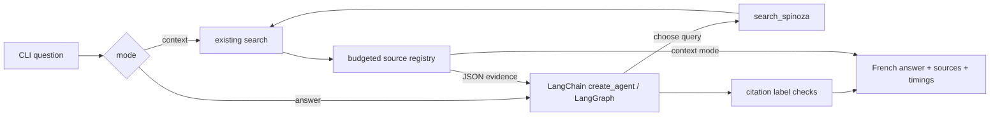

# Local research agent

## Commands

Run from the repository root after building the existing index and starting
Ollama with `qwen3:8b` and `qwen3-embedding:0.6b` already installed; see
[one-time setup](../README.md#one-time-setup):

```sh
uv run --locked python -m spinoza_rag.research context \
  'Selon les passages, quels éléments composent le premier genre de connaissance ? Limite la réponse à cette définition.' --top-k 1
uv run --locked python -m spinoza_rag.research answer \
  'Selon les passages, quels éléments composent le premier genre de connaissance ? Limite la réponse à cette définition.' --top-k 1 --timeout 600
```

`context` retrieves passages and provenance without constructing a chat model.
It still uses Ollama **embeddings**. `answer` asks the local model to choose
queries, optionally gather follow-up evidence, and answer in French with `[S1]`
citations. The `spinoza_rag.search` CLI stays retrieval-only. `--help` lists
index, model, retrieval, timeout and evidence limits. The timeout applies to
each request, not to the whole run.

The [answer review log](answer-review.md#observed-behavior) includes the
source-supported definition case used above, alongside broader questions whose
answers exceeded their evidence. Repeated runs can produce different output.

## Reading output and errors

On a successful research run, **stdout is a stream of JSON objects**, not one
JSON document: each progress event occupies one line, followed by the final
result object formatted across multiple lines. The final object includes
`answer`, `sources`, `events`, `evidence_bytes`, and `elapsed_seconds`; its
`events` list repeats the progress events. Context mode sets `answer` to `null`
and emits search events without model events.

The shortened example below shows selected fields from an answer run; other
fields and events are omitted. All text, identifiers, metadata, and numeric
values are illustrative placeholders, not corpus output or measurements.

Progress events on stdout:

```json
{"event": "model_start", "call": 1}
{"event": "search_start", "tool": "search_spinoza", "query": "<search query>"}
{"event": "search_end", "admitted_labels": ["S1"], "evidence_bytes": 500}
{"event": "model_end", "call": 2, "prompt_seconds": 0.1, "generation_seconds": 0.2}
```

The final result follows on stdout. This excerpt omits `events`; in actual
output it contains the full event list:

```json
{
  "answer": "<réponse française> [S1]",
  "sources": [
    {
      "label": "S1",
      "chunk_id": "sha256:<chunk hash>",
      "text": "<passage text omitted>",
      "metadata": {
        "source_file": "synthetic.pdf",
        "page_start": 1,
        "page_end": 1,
        "lecture_date": "1981-01-01"
      },
      "distance": 0.2
    }
  ],
  "evidence_bytes": 500,
  "elapsed_seconds": 0.5
}
```

`[S1]` resolves through `sources` to its chunk and provenance. The result lists
all admitted sources, including any the answer did not cite. A resolved label
alone does not establish that its passage supports the claim.

Failures write a summary to **stderr** and do not print a final result object.
Progress events already emitted remain on stdout, including available
`search_error`, `unknown_citations`, or `agent_error` details. For example, a
search against a missing index can emit these selected stdout events:

```json
{"event": "search_error", "error": "Persistent index is missing; run indexing first."}
{"event": "agent_error", "error": "Retrieval failed; no evidence admitted."}
```

The stderr summary is:

```text
Research failed: Local agent failed: Retrieval failed; no evidence admitted.
```

| Exit status | Meaning |
| --- | --- |
| `0` | A result was produced, including an explicit insufficient-evidence response when no retrieval error prevents it. `--help` also exits successfully without a result. |
| `1` | Research failed: invalid input limits, model or retrieval failure, rejected citations, or another execution error. |
| `2` | Argument parsing failed, such as an invalid mode or missing question. |

To retain both channels locally:

```sh
mkdir -p storage/research
uv run --locked python -m spinoza_rag.research answer \
  'Selon les passages, quels éléments composent le premier genre de connaissance ? Limite la réponse à cette définition.' \
  --top-k 1 --timeout 600 > storage/research/answer.log 2>&1
```

## Architecture and bounds



`ResearchSession` calls the search CLI's `search` function through an injected
retriever. That function shares `search_collection` with the evaluation, so
embedding identity, manifest checks, upstream checksums and ranking match the
evaluated path. Each search reopens and verifies the index. Passages are used
as retrieved, without adjacent-page expansion or reranking.

Each answer invocation creates a fresh graph without a checkpointer or store.
Context mode calls retrieval directly and creates no graph. The answer agent has
one tool, a lock-protected two-search limit (including failed attempts), three
model calls at most, and a graph recursion guard. Multiple tool calls in one
model response share the same limits. Excess searches return a tool error;
continued tool loops fail visibly. There is no multi-agent system, persistent
conversation, or web interface. See [configuration](configuration.md#local-chat-and-evidence-defaults)
for centralized model, question, output and evidence budgets.

Only complete chunks fitting the cumulative UTF-8 JSON evidence budget are
admitted. Labels are assigned in admission order and reused for each chunk ID;
duplicate passages are not resent. A later search can receive no new evidence
because its results duplicate earlier ones or the budget is full. The budget
bounds serialized evidence, not the exact tokenizer count of the whole prompt;
Ollama's model context window and per-call output cap are separate controls.
`--top-k 1` leaves room in the budget for a second search on another topic.

## Grounding and failures

The system prompt treats passages and metadata as untrusted data, requests
retrieval before corpus answers, requires citations and explicit acknowledgement
of insufficient evidence, and forbids outside knowledge. `ChatOllama` sets
`reasoning=False` explicitly, sending Ollama `think=false`.

The application withholds unsupported drafts when no evidence was admitted,
rejects unknown source labels, uncited substantive output and final responses
marked `done_reason=length`. Without citations, accept only the exact claim-free
refusal `Les preuves sont insuffisantes pour répondre.`, optionally followed by
the fixed methodological caution `Une similarité vectorielle ne prouve rien.`.
Other text following a refusal still requires citations. The prompt quotes the
refusal separately; see [the regression diagnosis](knowledge/agent-refusal-boundary.md).
A failure produces an actionable error and a nonzero CLI status. Tool retrieval
failures are visible and consume a slot; a later search can still admit evidence.
If any search fails and no evidence is admitted, the run fails with a nonzero
status. The fixed French no-evidence response is reserved for runs without
retrieval errors, including skipped retrieval or an exhausted evidence budget.

Citation checks share a parser for single labels, comma- or semicolon-separated
bracket groups (such as `[S1, S2]`), and single numeric labels in parentheses
(such as `(S1)`). Every parsed token must resolve to an admitted source;
malformed bracket tokens and unknown labels are rejected.

A valid label proves only that a source exists in the registry. It does **not**
prove entailment, relevance, completeness or factual grounding. Human inspection
of the answer against its actual passages remains necessary. Vector search
always returns nearest neighbors, including for unrelated questions; there is
no calibrated relevance cutoff. Prompt injection resistance is an instruction,
not a demonstrated security guarantee.

## Local observability and privacy

The CLI emits JSON events immediately, then a JSON result containing admitted
passages, full chunk IDs, source filename, PDF page range, available lecture
metadata, cosine distances and source labels. Model events include requested
tool calls, search queries, wall time, token counts and separate Ollama
`prompt_eval_duration` / `eval_duration` converted from nanoseconds to seconds.
Unavailable durations are `null`, never inferred from wall time. These values
exclude some loading, tool, graph and client overhead; `elapsed_seconds` on the
result measures research execution, excluding CLI model construction.

Chat endpoints follow the embedding client's loopback validation and ignore
proxy environment settings. Execution uses `tracing_context(enabled=False)`
even if LangSmith tracing is enabled in the parent environment; no cloud tracing
or hosted service is configured. Tests verify this override at the model boundary.
LangSmith and the LangGraph SDK are transitive dependencies, not services used
by the application. No custom tracing callbacks are accepted.

Redirect runs you want to keep to ignored `storage/research/`. Keep corpus passages,
generated answers, and execution traces there. Nothing is saved by default;
terminal scrollback and shell redirection remain the user's local responsibility.
Tracked documentation contains questions and metadata, never corpus quotations.

## Design tradeoffs

Offline ingestion, validated retrieval, and answer generation have separate
responsibilities. Retrieval uses a fixed index and an embedding response;
generation runs a fresh, bounded decision loop over that retrieval API. The
agent can rephrase a query or request a second topic, while Python enforces
budgets and source identity independently of prompt compliance. Context mode
makes the evidence inspectable before generation; answer mode includes source
mappings and execution events alongside the response.

A small evidence budget and page-boundary chunks can omit an argument's
continuation. A second search costs another model round trip and may return
only duplicates. Citation resolution is cheap and testable, while semantic
faithfulness needs source review. Retrieval evaluation remains a separate
frozen experiment: informal answer checks cannot improve its scores or
establish answer quality. Adjacent-page context and reranking remain deferred
experiments with their own evaluation requirements.

## API references

- [LangChain create_agent](https://reference.langchain.com/python/langchain/agents/factory/create_agent)
- [ChatOllama parameters](https://reference.langchain.com/python/langchain-ollama/langchain_ollama/chat_models/ChatOllama)
